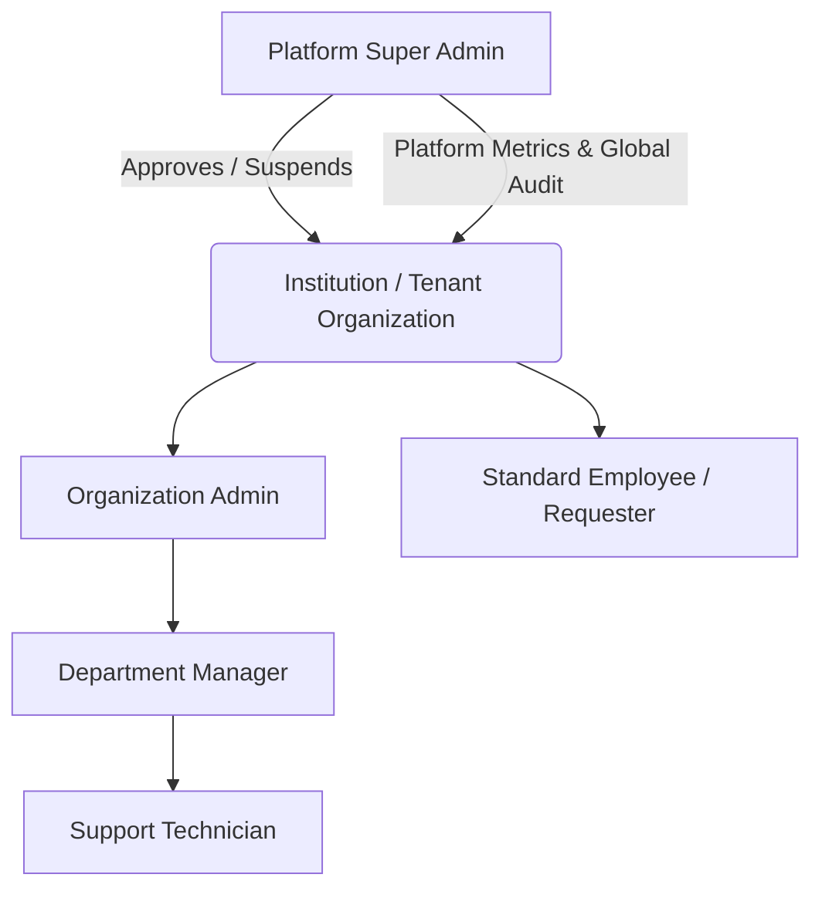
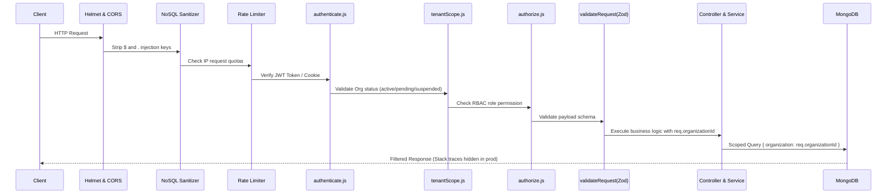

# TechDesk System Architecture

## 1. Executive Summary & Core Architecture

**TechDesk: Smart IT Support and Incident Management System** is built on the **MERN** stack (MongoDB, Express, React, Node.js) with real-time WebSocket communication (Socket.IO) and asynchronous background job queues (Redis + BullMQ).

TechDesk is engineered as an **Enterprise Multi-Organization Platform (Shared Database, Tenant-Isolated Collections)**. Multiple independent institutions (universities, hospitals, enterprise corporations, NGOs, and government agencies) operate securely on a single platform instance with guaranteed logical data isolation, custom branding, localized SLA policies, and dedicated administrative controls.

```
                      +---------------------------------------+
                      |         Web Client Browser            |
                      |   (React 18 + Vite + TailwindCSS)     |
                      +-------------------+-------------------+
                                          |
                        HTTPS (REST API)  |  WSS (Socket.IO)
                                          v
                      +---------------------------------------+
                      |       Nginx / Gateway Proxy           |
                      |   (SSL Termination, Rate Limiting)    |
                      +-------------------+-------------------+
                                          |
                                          v
                      +---------------------------------------+
                      |         Node.js / Express API         |
                      |  [Auth -> TenantScope -> RBAC -> Zod] |
                      +---------+-------------------+---------+
                                |                   |
                 Mongoose ODM   |                   |  BullMQ / ioredis
                                v                   v
                  +--------------------+     +-------------------+
                  |  MongoDB 7.0 Cluster|     |   Redis 7.2 Cache |
                  | (Tenant Partition) |     |  & Queue Storage  |
                  +--------------------+     +-------------------+
```

---

## 2. Multi-Organization Tenant Isolation Architecture

### 2.1 Isolation Strategy
- **Shared Database, Shared Schema, Foreign-Key Isolation**: All tenant data resides in high-performance shared collections (`tickets`, `users`, `teams`, `attachments`, `notifications`, `slapolicies`, `auditlogs`), with every resource bound to an immutable `organization: ObjectId` field.
- **Server-Side Trust Context**: Organization IDs are **never** trusted from user input or request bodies. Tenant membership is derived exclusively from the authenticated JWT session or verified user database record.
- **Tenant Scope Middleware ([tenantScope.js](file:///home/firo2504/Desktop/TechDesk/backend/src/middleware/tenantScope.js))**:
  1. Inspects the authenticated user's organization reference.
  2. Queries the database to verify the organization exists and maintains an active status.
  3. Binds `req.organizationId = user.organization._id.toString()`.
  4. Intercepts incoming query parameters (`req.query.organization`, `req.query.organizationId`) and rejects any attempts to tamper with or query foreign tenant data with HTTP `403 Forbidden`.
- **Query Hardening & IDOR Prevention**: Every database query in services strictly includes `{ organization: req.organizationId }`. Direct lookups by ID (e.g., tickets, comments, timeline events, attachments) fail with `404 Not Found` if the requested resource does not belong to the user's organization, completely eliminating Insecure Direct Object References (IDOR).

---

## 3. Dual-Tier Administrative Hierarchy

TechDesk features a strict two-tier privilege hierarchy:



### Tier 1: Platform Super Admin (`superadmin`)
- **Scope**: Platform-wide. Does not belong to any specific organization (`user.organization = null`).
- **Capabilities**:
  - Review and approve/reject new institution registration requests.
  - Suspend organizations in real-time (immediately revoking API access and disconnecting WebSockets).
  - Reactivate organizations to restore full workspace privileges.
  - Inspect global cross-tenant platform growth and metrics.
  - Access global audit trails to investigate security incidents across tenants.
  - Inspect attachments across tenants specifically for escalated platform support.

### Tier 2: Tenant-Level Roles
- **Organization Admin (`admin`)**: Manages organization business hours, user accounts, departmental teams, SLA targets, and tenant-scoped audit logs. Cannot access platform administration or view any other tenant's records.
- **Manager (`manager`)**: Supervises ticket assignment, balances technician queues, reassigns tickets, initiates manual SLA monitoring scans, and exports CSV analytics.
- **Technician (`technician`)**: Accepts assigned tickets, transitions statuses, writes resolution notes, records internal comments, and tracks SLA countdowns.
- **Employee (`employee`)**: Submits support requests, tracks ticket progress, responds to technician requests via comments, and reviews personal notifications.

---

## 4. Request Lifecycle & Middleware Pipeline

Every HTTP request to a protected API endpoint traverses a defense-in-depth pipeline:



---

## 5. Real-Time WebSocket Architecture (Socket.IO)

TechDesk provides bi-directional, event-driven updates for ticket status changes, assignment notifications, and comment feeds using **Socket.IO**.

### 5.1 Connection & Handshake Authentication
1. Socket client transmits JWT via `socket.handshake.auth.token`, `headers.authorization`, or cookie.
2. Connection middleware verifies JWT signature against `JWT_SECRET`.
3. Verifies user account is active (`isActive: true`).
4. Verifies organization status: Non-superadmin users with `pending` or `suspended` status are rejected with `WebSocket connection denied: Organization status is '<status>'`.

### 5.2 Dynamic Room Partitioning
Upon successful connection, users are automatically placed into isolated communication channels:
- `user:<userId>`: Personal inbox for notifications, assignment alerts, and mention updates.
- `org:<organizationId>`: Tenant broadcast channel for organization-wide announcements and team metrics.
- `role:<orgId>:<role>`: Scoped broadcast channel for specific teams (e.g., alerting all technicians in Hospital A).
- `platform:superadmin`: Exclusive channel for Platform Super Admins to receive platform events (new registrations, suspensions).

### 5.3 Ticket Room Authorization (`ticket:join`)
Clients cannot join arbitrary rooms. When a user requests to join `ticket:join`:
1. Server verifies ticket existence.
2. Server verifies `ticket.organization.toString() === socket.orgId`. Cross-tenant join attempts emit an `error` event: `"Unauthorized: Ticket belongs to a different organization"`.
3. For employee roles, server verifies `ticket.creator.toString() === user._id.toString()`, ensuring employees can only receive live events on tickets they own.

---

## 6. Attachment Storage and Security Architecture

- **Dual-Layer Format Validation**: Validates both MIME type (magic bytes header) and file extension against a strict whitelist (PDF, JPG, PNG, WEBP, GIF, DOCX, TXT, CSV, ZIP). Executable formats (.exe, .sh, .bat, .php, .js) are strictly rejected.
- **Sanitized Random Naming**: Files are stored with random hex prefixes and alphanumeric sanitization (`<timestamp>-<hex>-<sanitized_name>.<ext>`) to prevent path traversal and file collisions.
- **Protected Access Route**: Static file serving via `/uploads` is replaced with an authenticated proxy route (`/api/attachments/:id/download`). The endpoint enforces:
  1. Valid JWT authentication.
  2. Ticket tenant validation against `req.organizationId`.
  3. Role permissions (Employees can only download attachments on tickets they submitted).

---

## 7. Intelligent SLA Management Engine

- **Localized Multi-Tier Policies**: Each tenant maintains customized [SLAPolicy](file:///home/firo2504/Desktop/TechDesk/backend/src/models/SLAPolicy.js) definitions covering:
  - Critical Priority (Default: 15m Response, 2h Resolution)
  - High Priority (Default: 1h Response, 8h Resolution)
  - Medium Priority (Default: 4h Response, 24h Resolution)
  - Low Priority (Default: 8h Response, 48h Resolution)
- **Automatic Deadline Calculation**: Upon ticket creation, deadlines (`sla.responseDeadline`, `sla.resolutionDeadline`) are computed using tenant business hours and priority thresholds.
- **Background Breach Scanning**: Powered by BullMQ and Redis (with in-process developmental fallback). Repeatable scheduled jobs scan active tickets every 5 minutes. Tickets nearing breach trigger automated warnings, while breached tickets trigger escalation notifications and audit events.

---

## 8. Directory & Folder Structure

### Backend Structure (`backend/`)
```
backend/
├── data/backups/         # Database backup dumps and verification logs
├── scripts/              # Seed scripts, test harnesses, and superadmin provisioners
├── src/
│   ├── config/           # Database, environment, storage, CORS, and Redis configs
│   ├── controllers/      # HTTP request handlers (auth, ticket, superadmin, etc.)
│   ├── jobs/             # BullMQ queue definitions and SLA background workers
│   ├── middleware/       # authenticate, authorize, tenantScope, upload, rateLimiter
│   ├── models/           # Mongoose schemas (Organization, User, Ticket, etc.)
│   ├── routes/           # Express router endpoints
│   ├── services/         # Business logic & tenant-scoped database queries
│   ├── sockets/          # Socket.IO connection handlers and event emitters
│   ├── utils/            # ApiResponse, ApiError, Winston logger
│   ├── validators/       # Zod schemas for input validation
│   ├── app.js            # Express app configuration & middleware pipeline
│   └── server.js         # HTTP server & WebSocket bootstrap
└── tests/                # Vitest unit and integration test suites
```

### Frontend Structure (`frontend/`)
```
frontend/
├── public/               # Favicon and static web assets
├── src/
│   ├── components/       # Reusable UI components, modals, tables, and layouts
│   │   ├── layout/       # Sidebar, Navbar, PublicNavbar
│   │   └── tickets/      # TicketCard, StatusBadge, PriorityBadge, CommentList
│   ├── contexts/         # AuthContext (JWT & roles), SocketContext (Real-time)
│   ├── pages/            # Application views
│   │   ├── auth/         # Login, RegisterOrganization, ForgotPassword
│   │   ├── dashboard/    # Employee, Technician, Manager, Admin dashboards
│   │   ├── tickets/      # TicketList, TicketDetail, CreateTicket
│   │   └── superadmin/   # SuperAdminDashboard, OrganizationList, RegistrationRequests
│   ├── routes/           # ProtectedRoute, SuperAdminRoute, AppRoutes
│   ├── services/         # Axios / Fetch client wrappers (api, superadminService)
│   └── utils/            # Constants, date formatters, permissions matrix
├── index.html            # Single Page Application HTML root
└── vite.config.js        # Vite bundler configuration
```
