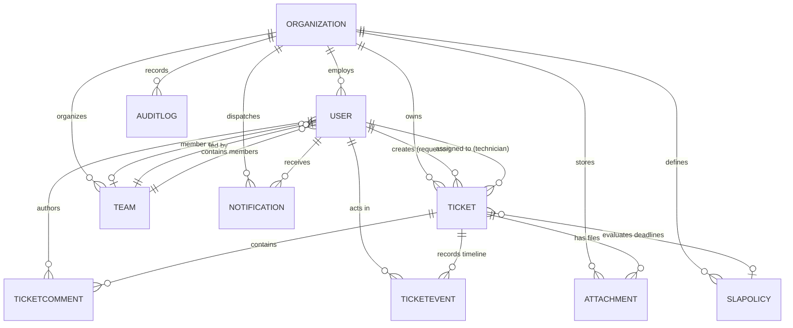

# TechDesk Database Architecture & Schema Reference

TechDesk utilizes **MongoDB 7.0+** with **Mongoose 8** ODM. The database architecture follows the **Shared Database, Tenant-Partitioned Collections** pattern, providing scalable multi-tenancy with guaranteed logical data isolation.

- **Default Database Name**: `techdesk`
- **Total Collections**: 10 collections
- **Isolation Key**: `organization` (`ObjectId`, referencing `Organization`) present on all tenant-owned models.

---

## 1. Entity-Relationship Diagram (ERD)

---

## 2. Collection & Model Specifications

### 2.1 Collection: `organizations` (Model: `Organization`)
Stores tenant institutions registered on the platform.

| Field Name | Type | Constraints / Default | Description |
|---|---|---|---|
| `_id` | `ObjectId` | Auto-generated PK | Unique organization identifier |
| `name` | `String` | Required, Trimmed | Institution name (e.g. St. Jude Hospital) |
| `slug` | `String` | Required, Unique, Lowercase | URL-safe identifier (e.g. `st-jude-hospital`) |
| `domain` | `String` | Optional, Lowercase, Indexed | Verified institutional domain (e.g. `stjude.org`) |
| `type` | `String` | Enum, Default: `'Enterprise'` | `'University / College'`, `'Hospital / Healthcare'`, `'Enterprise'`, `'Government Institution'`, `'Non-Profit / NGO'`, `'Other'` |
| `officialEmail`| `String` | Optional, Lowercase | Organization public contact email |
| `phone` | `String` | Optional | Organization contact phone number |
| `address` | `String` | Optional | Physical mailing address |
| `website` | `String` | Optional | Institutional portal URL |
| `status` | `String` | Enum, Default: `'pending'` | `'active'`, `'pending'`, `'suspended'`, `'rejected'` |
| `plan` | `String` | Enum, Default: `'standard'` | `'standard'`, `'pro'`, `'enterprise'` |
| `suspendedReason`| `String`| Optional | Administrative justification for suspension |
| `suspendedAt` | `Date` | Optional | Timestamp of platform suspension |
| `rejectionReason`| `String`| Optional | Explanation for rejected self-registration |
| `settings` | `Object` | Nested subdocument | Organization operational preferences |
| `settings.allowRegistration` | `Boolean` | Default: `true` | Permits employee self-registration via slug |
| `settings.defaultTicketPriority` | `String` | Enum, Default: `'Medium'` | `'Low'`, `'Medium'`, `'High'`, `'Critical'` |
| `settings.businessHours.start` | `String` | Default: `'09:00'` | Daily SLA clock start time (HH:MM) |
| `settings.businessHours.end` | `String` | Default: `'18:00'` | Daily SLA clock stop time (HH:MM) |
| `settings.businessHours.timeZone` | `String` | Default: `'UTC'` | IANA timezone string |
| `createdAt` | `Date` | Auto | Creation timestamp |
| `updatedAt` | `Date` | Auto | Last modification timestamp |

**Indexes**:
- `{ slug: 1 }` (Unique)
- `{ domain: 1 }`
- `{ status: 1 }`

---

### 2.2 Collection: `users` (Model: `User`)
Stores Platform Super Admins and tenant personnel (Admins, Managers, Technicians, Employees).

| Field Name | Type | Constraints / Default | Description |
|---|---|---|---|
| `_id` | `ObjectId` | Auto-generated PK | Unique user identifier |
| `name` | `String` | Required, Trimmed | Full legal / display name |
| `email` | `String` | Required, Unique, Lowercase | Unique login email address |
| `password` | `String` | Required, `select: false` | bcrypt hashed password (cost factor 10) |
| `role` | `String` | Enum, Default: `'employee'` | `'superadmin'`, `'admin'`, `'manager'`, `'technician'`, `'employee'` |
| `organization`| `ObjectId`| Ref: `'Organization'`, Indexed | Null for `superadmin`, required for tenant roles |
| `team` | `ObjectId` | Ref: `'Team'`, Optional | Assigned departmental support team |
| `skills` | `[String]` | Default: `[]` | Technical tags (e.g., `'Network'`, `'Security'`) |
| `avatar` | `String` | Default: Gravatar / placeholder | Profile photo image URL |
| `isActive` | `Boolean` | Default: `true`, Indexed | Account operational state |
| `resetPasswordToken` | `String` | `select: false` | SHA-256 hashed password reset token |
| `resetPasswordExpires` | `Date` | `select: false` | Expiration timestamp for password reset |
| `lastLoginAt` | `Date` | Optional | Timestamp of most recent login |

**Indexes**:
- `{ email: 1 }` (Unique)
- `{ organization: 1 }`
- `{ role: 1 }`
- `{ isActive: 1 }`

---

### 2.3 Collection: `tickets` (Model: `Ticket`)
Stores incident tickets, service requests, and hardware/software problem reports.

| Field Name | Type | Constraints / Default | Description |
|---|---|---|---|
| `_id` | `ObjectId` | Auto-generated PK | Unique ticket identifier |
| `ticketNumber`| `String` | Required, Unique, Indexed | Reference code (`TD-1001`, `TD-1002`) |
| `title` | `String` | Required, Trimmed | Short incident summary |
| `description`| `String` | Required, Trimmed | Detailed issue description |
| `category` | `String` | Enum, Default: `'Software'` | `'Hardware'`, `'Software'`, `'Network'`, `'Security'`, `'Account'`, `'Other'` |
| `priority` | `String` | Enum, Default: `'Medium'` | `'Low'`, `'Medium'`, `'High'`, `'Critical'` |
| `status` | `String` | Enum, Default: `'Open'` | `'Open'`, `'Assigned'`, `'In Progress'`, `'Pending User'`, `'Resolved'`, `'Closed'` |
| `creator` | `ObjectId` | Required, Ref: `'User'` | User who reported the incident |
| `assignee` | `ObjectId` | Optional, Ref: `'User'` | Technician responsible for ticket resolution |
| `organization`| `ObjectId`| Required, Ref: `'Organization'` | Owning tenant organization |
| `team` | `ObjectId` | Optional, Ref: `'Team'` | Assigned support team |
| `tags` | `[String]` | Default: `[]` | Categorical labels |
| `sla.responseDeadline` | `Date` | Optional | Target timestamp for first technician response |
| `sla.resolutionDeadline`| `Date` | Optional | Target timestamp for final resolution |
| `sla.firstResponseAt` | `Date` | Optional | Actual timestamp of first technician response |
| `sla.resolvedAt` | `Date` | Optional | Actual timestamp ticket transitioned to Resolved |
| `sla.isResponseBreached` | `Boolean` | Default: `false` | True if response target was exceeded |
| `sla.isResolutionBreached`| `Boolean`| Default: `false` | True if resolution target was exceeded |
| `resolutionNotes` | `String` | Default: `''` | Explanation written upon ticket resolution |
| `closedAt` | `Date` | Optional | Timestamp ticket was closed |
| `reopenedAt` | `Date` | Optional | Timestamp ticket was reopened from Closed |
| `reopenCount` | `Number` | Default: `0` | Number of times ticket was reopened |

**Compound Indexes (Tenant Scoped Optimization)**:
- `{ ticketNumber: 1 }` (Unique)
- `{ organization: 1, status: 1 }`
- `{ organization: 1, priority: 1 }`
- `{ organization: 1, assignee: 1 }`
- `{ organization: 1, creator: 1 }`
- `{ organization: 1, createdAt: -1 }`

---

### 2.4 Collection: `ticketcomments` (Model: `TicketComment`)
Stores discussion notes, user replies, and internal technician communication.

| Field Name | Type | Constraints / Default | Description |
|---|---|---|---|
| `_id` | `ObjectId` | Auto-generated PK | Unique comment identifier |
| `ticket` | `ObjectId` | Required, Ref: `'Ticket'`, Indexed | Parent ticket |
| `author` | `ObjectId` | Required, Ref: `'User'` | User who wrote the comment |
| `organization`| `ObjectId`| Required, Ref: `'Organization'`, Indexed | Owning tenant organization |
| `content` | `String` | Required, Trimmed | Markdown or plain-text comment content |
| `isInternal` | `Boolean` | Default: `false` | True if hidden from standard employee users |
| `attachments`| `[ObjectId]`| Ref: `'Attachment'` | Optional file attachments |

---

### 2.5 Collection: `ticketevents` (Model: `TicketEvent`)
Stores non-repudiable audit logs of every action performed on a ticket.

| Field Name | Type | Constraints / Default | Description |
|---|---|---|---|
| `_id` | `ObjectId` | Auto-generated PK | Unique event identifier |
| `ticket` | `ObjectId` | Required, Ref: `'Ticket'`, Indexed | Related ticket |
| `actor` | `ObjectId` | Required, Ref: `'User'` | User who performed the action |
| `organization`| `ObjectId`| Required, Ref: `'Organization'`, Indexed | Owning tenant organization |
| `type` | `String` | Enum | `'CREATED'`, `'STATUS_CHANGED'`, `'REASSIGNED'`, `'PRIORITY_CHANGED'`, `'COMMENT_ADDED'`, `'ATTACHMENT_ADDED'` |
| `details` | `Object` | Optional | Metadata (e.g. `{ from: 'Open', to: 'In Progress' }`) |

---

### 2.6 Collection: `attachments` (Model: `Attachment`)
Stores metadata and filesystem paths for files uploaded to tickets.

| Field Name | Type | Constraints / Default | Description |
|---|---|---|---|
| `_id` | `ObjectId` | Auto-generated PK | Unique attachment identifier |
| `filename` | `String` | Required | Sanitized unique filename on disk |
| `originalName`| `String` | Required | Original upload filename |
| `mimeType` | `String` | Required | Validated MIME type |
| `size` | `Number` | Required | File size in bytes (max 10MB) |
| `path` | `String` | Required | Absolute or relative file storage path |
| `uploader` | `ObjectId` | Required, Ref: `'User'` | User who uploaded the file |
| `ticket` | `ObjectId` | Required, Ref: `'Ticket'`, Indexed | Related ticket |
| `organization`| `ObjectId`| Required, Ref: `'Organization'`, Indexed | Owning tenant organization |

---

### 2.7 Collection: `slapolicies` (Model: `SLAPolicy`)
Stores localized Service Level Agreement response and resolution targets for an organization.

| Field Name | Type | Constraints / Default | Description |
|---|---|---|---|
| `_id` | `ObjectId` | Auto-generated PK | Unique policy identifier |
| `name` | `String` | Required, Trimmed | Policy title (e.g. Standard Healthcare SLA) |
| `organization`| `ObjectId`| Required, Ref: `'Organization'`, Indexed | Owning tenant organization |
| `isDefault` | `Boolean` | Default: `false` | True if automatically assigned to new tickets |
| `priorities.Critical.responseTimeMinutes` | `Number` | Default: `15` | Critical response target (minutes) |
| `priorities.Critical.resolutionTimeMinutes` | `Number` | Default: `120` | Critical resolution target (minutes) |
| `priorities.High.responseTimeMinutes` | `Number` | Default: `60` | High response target (minutes) |
| `priorities.High.resolutionTimeMinutes` | `Number` | Default: `480` | High resolution target (minutes) |
| `priorities.Medium.responseTimeMinutes` | `Number` | Default: `240` | Medium response target (minutes) |
| `priorities.Medium.resolutionTimeMinutes` | `Number` | Default: `1440` | Medium resolution target (minutes) |
| `priorities.Low.responseTimeMinutes` | `Number` | Default: `480` | Low response target (minutes) |
| `priorities.Low.resolutionTimeMinutes` | `Number` | Default: `2880` | Low resolution target (minutes) |
| `escalationEmail` | `String` | Optional | Destination for automated breach alerts |
| `isActive` | `Boolean` | Default: `true` | Policy status |

---

### 2.8 Collection: `teams` (Model: `Team`)
Stores departmental IT groups and technician assignments.

| Field Name | Type | Constraints / Default | Description |
|---|---|---|---|
| `_id` | `ObjectId` | Auto-generated PK | Unique team identifier |
| `name` | `String` | Required, Trimmed | Team name (e.g. Infrastructure Support) |
| `organization`| `ObjectId`| Required, Ref: `'Organization'`, Indexed | Owning tenant organization |
| `lead` | `ObjectId` | Optional, Ref: `'User'`, Indexed | Assigned team lead / supervisor |
| `members` | `[ObjectId]`| Ref: `'User'` | Member technicians |
| `specialties` | `[String]` | Default: `[]` | Categories handled (`Hardware`, `Network`, etc.) |

---

### 2.9 Collection: `notifications` (Model: `Notification`)
Stores real-time alerts and user notification inbox items.

| Field Name | Type | Constraints / Default | Description |
|---|---|---|---|
| `_id` | `ObjectId` | Auto-generated PK | Unique notification identifier |
| `recipient` | `ObjectId` | Required, Ref: `'User'`, Indexed | Receiving user |
| `organization`| `ObjectId`| Required, Ref: `'Organization'`, Indexed | Owning tenant organization |
| `title` | `String` | Required | Short headline |
| `message` | `String` | Required | Notification message body |
| `type` | `String` | Enum | `'TICKET_ASSIGNED'`, `'STATUS_CHANGED'`, `'COMMENT_ADDED'`, `'SLA_BREACH'`, `'SYSTEM'` |
| `link` | `String` | Optional | Frontend route (e.g. `/tickets/TD-1001`) |
| `isRead` | `Boolean` | Default: `false`, Indexed | Read state indicator |

---

### 2.10 Collection: `auditlogs` (Model: `AuditLog`)
Stores platform and tenant security audit logs.

| Field Name | Type | Constraints / Default | Description |
|---|---|---|---|
| `_id` | `ObjectId` | Auto-generated PK | Unique audit entry identifier |
| `organization`| `ObjectId`| Optional, Ref: `'Organization'`, Indexed | Null for global platform actions |
| `actor` | `ObjectId` | Required, Ref: `'User'`, Indexed | User who triggered the event |
| `action` | `String` | Required, Indexed | E.g. `'ORGANIZATION_APPROVED'`, `'ORGANIZATION_SUSPENDED'`, `'USER_LOGGED_IN'` |
| `resource` | `String` | Required | E.g. `'Organization'`, `'Ticket'`, `'User'` |
| `resourceId` | `ObjectId` | Optional | Identifier of target resource |
| `details` | `Object` | Optional | Sanitized event context (passwords stripped) |
| `ipAddress` | `String` | Optional | Client IP address |
| `userAgent` | `String` | Optional | Client browser User-Agent header |
