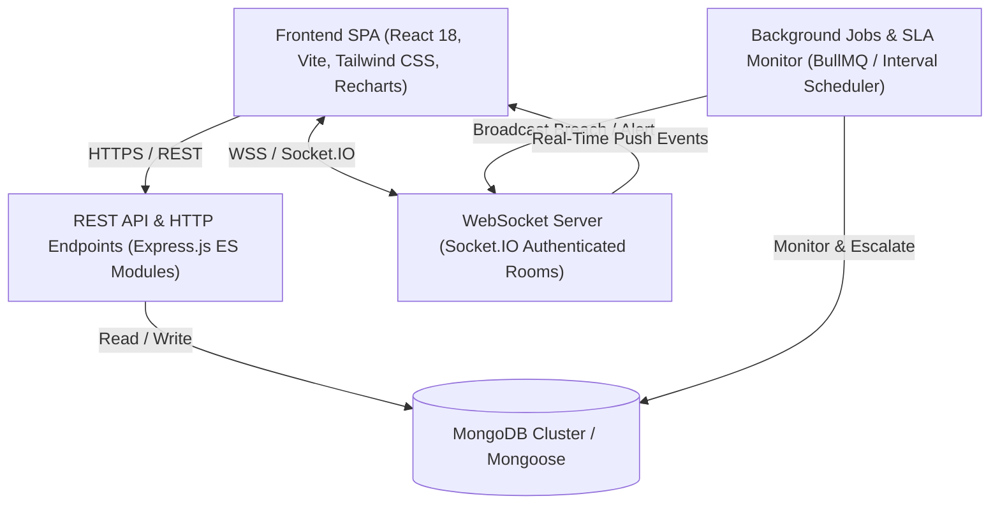

# TechDesk System Architecture & Technical Design

## 1. Executive Architecture Summary

**TechDesk** is an enterprise-grade Smart IT Support and Incident Management System built on the MERN stack with event-driven real-time updates via Socket.IO, intelligent skill/workload-based automated ticket routing, deterministic SLA deadline tracking with automated breach detection and escalations, and strict multi-tenant organization scoping.



---

## 2. Layered Architecture

The backend follows a clean, decoupled modular architecture separating cross-cutting concerns:

```
src/
├── config/        # Environment validation, database connectivity, CORS, storage
├── models/        # Mongoose data schemas, indexes, and instance/static methods
├── controllers/   # Request extraction, parameter parsing, and response formatting
├── services/      # Core business logic, transactional operations, and calculations
├── routes/        # Endpoint routing, rate limiting, and middleware binding
├── middleware/    # Auth, authorization, tenant isolation, validation, upload, error handling
├── validators/    # Zod schema definitions for strict payload validation
├── jobs/          # Persistent BullMQ queues, workers, and fallback schedulers
├── sockets/       # Authenticated WebSocket server, room scoping, and event broadcasters
└── utils/         # Structured logger, ApiError, and ApiResponse wrappers
```

---

## 3. Real-Time Event Architecture (Socket.IO)

TechDesk establishes bi-directional authenticated WebSocket connections. Each connected client is joined into fine-grained rooms:

- `org:<organizationId>`: Receives organization-wide ticket created/updated broadcasts.
- `user:<userId>`: Receives direct notifications, assignments, and personal alerts.
- `role:<orgId>:<role>`: Scoped broadcasts for managers, technicians, or administrators.
- `ticket:<ticketId>`: Dedicated room for live collaboration on an individual ticket (new comments, attachments, status changes).

### Event Catalogue

| Event Name | Scope | Description |
| :--- | :--- | :--- |
| `ticket:created` | `org:<id>` | Fired when a new ticket is submitted |
| `ticket:status_changed` | `ticket:<id>`, `org:<id>` | Fired on lifecycle state transitions |
| `ticket:assigned` | `user:<assigneeId>`, `ticket:<id>` | Fired when ticket is assigned or reassigned |
| `ticket:comment_added` | `ticket:<id>` | Real-time comment stream (public or internal) |
| `ticket:sla_breached` | `org:<id>`, `user:<assigneeId>` | Fired when response or resolution SLA expires |
| `notification:new` | `user:<userId>` | Push alert toast delivered to recipient |

---

## 4. Intelligent Technician Auto-Assignment Algorithm

When an employee submits a ticket, the system automatically evaluates available technicians:

1. **Candidate Pool**: Filters all active technicians belonging to the ticket's organization.
2. **Category Skill Matching**: Awards `+30 points` if technician's `skills` array contains the ticket category.
3. **Team Specialty Matching**: Awards `+20 points` if technician's team specializes in the category.
4. **Workload Penalty**: Calculates active unresolved workload (`Assigned`, `In Progress`, `Pending User`) and subtracts `5 points` per active ticket.
5. **Selection**: Assigns the technician with the highest overall score, automatically moving ticket status from `Open` to `Assigned` and dispatching real-time notifications.

---

## 5. Automated SLA Engine & Escalation

- **Deadline Calculation**: Upon creation, SLA deadlines (`responseDeadline`, `resolutionDeadline`) are calculated using the organization's active policy priority thresholds.
- **Background Worker**: Evaluates unresolved tickets every 60 seconds.
- **Breach Handling**: If `Date.now() > resolutionDeadline`, sets `isResolutionBreached = true`, logs an audit event, notifies the assignee, alerts managers, and broadcasts to live dashboards.
- **Critical Auto-Escalation**: Critical incidents unresolved for over 2 hours automatically escalate to executive management review.
