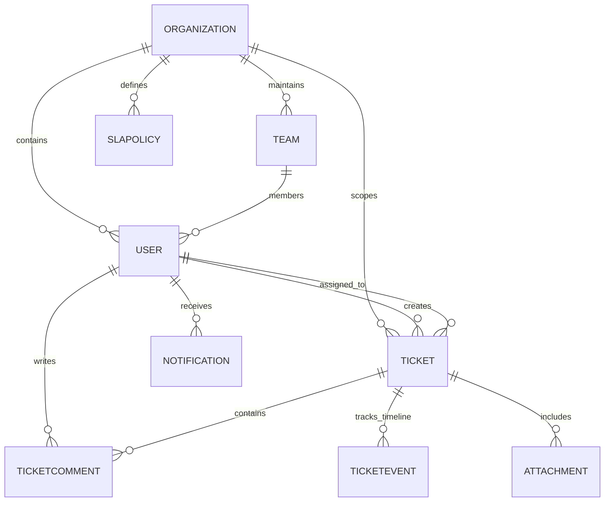

# TechDesk Database Schema Reference

## Database Engine
- Engine: MongoDB 7.0+
- ODM: Mongoose 8.x
- Naming Convention: PascalCase model names, camelCase fields, snake_case or ISO timestamps.

---

## Entity Relationship Overview

---

## Collections & Schemas

### 1. `organizations`
- `_id`: ObjectId
- `name`: String, required
- `slug`: String, unique, indexed
- `domain`: String
- `logoUrl`: String
- `settings`:
  - `allowRegistration`: Boolean (default: true)
  - `defaultTicketPriority`: Enum ('Low', 'Medium', 'High', 'Critical')
  - `businessHours`: { start: String, end: String, timeZone: String }
- `createdAt`, `updatedAt`: Date

### 2. `users`
- `_id`: ObjectId
- `name`: String, required
- `email`: String, required, unique, lowercase, indexed
- `password`: String (hashed with bcrypt 10 rounds, `select: false`)
- `role`: Enum ('employee', 'technician', 'manager', 'admin')
- `organization`: ObjectId (ref: Organization), indexed
- `team`: ObjectId (ref: Team, nullable)
- `skills`: Array of Strings (e.g. `['Hardware', 'Network', 'Software']`)
- `avatar`: String (URL)
- `isActive`: Boolean (default: true)
- `resetPasswordToken`: String (hashed token, `select: false`)
- `resetPasswordExpires`: Date (`select: false`)
- `lastLoginAt`: Date
- `createdAt`, `updatedAt`: Date

### 3. `teams`
- `_id`: ObjectId
- `name`: String, required
- `organization`: ObjectId (ref: Organization), indexed
- `lead`: ObjectId (ref: User)
- `members`: Array of ObjectIds (ref: User)
- `specialties`: Array of Strings (`['Hardware', 'Software', 'Network']`)
- `isActive`: Boolean (default: true)
- `createdAt`, `updatedAt`: Date

### 4. `tickets`
- `_id`: ObjectId
- `ticketNumber`: String, unique, indexed (format: `TD-XXXX`)
- `title`: String, required
- `description`: String, required
- `category`: Enum ('Hardware', 'Software', 'Network', 'Account', 'Security', 'Other')
- `priority`: Enum ('Low', 'Medium', 'High', 'Critical')
- `status`: Enum ('Open', 'Assigned', 'In Progress', 'Pending User', 'Resolved', 'Closed')
- `creator`: ObjectId (ref: User), indexed
- `assignee`: ObjectId (ref: User), indexed
- `team`: ObjectId (ref: Team), indexed
- `organization`: ObjectId (ref: Organization), indexed
- `attachments`: Array of ObjectIds (ref: Attachment)
- `slaPolicy`: ObjectId (ref: SLAPolicy)
- `sla`:
  - `responseDeadline`: Date
  - `respondedAt`: Date
  - `isResponseBreached`: Boolean (default: false)
  - `resolutionDeadline`: Date
  - `resolvedAt`: Date
  - `isResolutionBreached`: Boolean (default: false)
  - `escalated`: Boolean (default: false)
  - `escalatedAt`: Date
  - `escalationReason`: String
- `resolutionNotes`: String
- `closedAt`, `reopenedAt`: Date
- `reopenCount`: Number (default: 0)
- `createdAt`, `updatedAt`: Date
- Indexes:
  - `{ organization: 1, status: 1 }`
  - `{ organization: 1, priority: 1 }`
  - `{ organization: 1, assignee: 1 }`
  - `{ organization: 1, creator: 1 }`
  - `{ organization: 1, createdAt: -1 }`

### 5. `ticketcomments`
- `_id`: ObjectId
- `ticket`: ObjectId (ref: Ticket), indexed
- `author`: ObjectId (ref: User), required
- `organization`: ObjectId (ref: Organization), indexed
- `content`: String, required
- `isInternal`: Boolean (default: false)
- `attachments`: Array of ObjectIds (ref: Attachment)
- `createdAt`, `updatedAt`: Date

### 6. `ticketevents` (Audit Trail)
- `_id`: ObjectId
- `ticket`: ObjectId (ref: Ticket), indexed
- `organization`: ObjectId (ref: Organization), indexed
- `actor`: ObjectId (ref: User, nullable for system actions)
- `eventType`: Enum ('CREATED', 'ASSIGNED', 'REASSIGNED', 'STATUS_CHANGED', 'COMMENT_ADDED', 'ATTACHMENT_ADDED', 'SLA_BREACH', 'ESCALATED', 'RESOLVED', 'CLOSED', 'REOPENED')
- `details`: Mixed Object
- `message`: String, required
- `createdAt`: Date

### 7. `slapolicies`
- `_id`: ObjectId
- `name`: String, required
- `description`: String
- `organization`: ObjectId (ref: Organization), indexed
- `isDefault`: Boolean
- `priorities`:
  - `Critical`: { responseTimeMinutes: 15, resolutionTimeMinutes: 120 }
  - `High`: { responseTimeMinutes: 60, resolutionTimeMinutes: 480 }
  - `Medium`: { responseTimeMinutes: 240, resolutionTimeMinutes: 1440 }
  - `Low`: { responseTimeMinutes: 480, resolutionTimeMinutes: 2880 }
- `escalationEmail`: String
- `isActive`: Boolean

### 8. `notifications`
- `_id`: ObjectId
- `recipient`: ObjectId (ref: User), indexed
- `organization`: ObjectId (ref: Organization), indexed
- `title`: String, required
- `message`: String, required
- `type`: Enum ('TICKET_CREATED', 'TICKET_ASSIGNED', 'STATUS_CHANGED', 'NEW_COMMENT', 'SLA_WARNING', 'SLA_BREACH', 'ESCALATION', 'SYSTEM')
- `ticket`: ObjectId (ref: Ticket)
- `isRead`: Boolean (default: false), indexed
- `readAt`: Date
- `createdAt`: Date

### 9. `attachments`
- `_id`: ObjectId
- `originalName`: String
- `filename`: String
- `mimeType`: String
- `size`: Number
- `path`: String
- `uploader`: ObjectId (ref: User)
- `organization`: ObjectId (ref: Organization)
- `ticket`: ObjectId (ref: Ticket)
- `createdAt`: Date

### 10. `auditlogs`
- `_id`: ObjectId
- `organization`: ObjectId (ref: Organization), indexed
- `actor`: ObjectId (ref: User), indexed
- `action`: String, indexed
- `resource`: String
- `resourceId`: String
- `details`: Mixed Object
- `ipAddress`: String
- `userAgent`: String
- `createdAt`: Date
